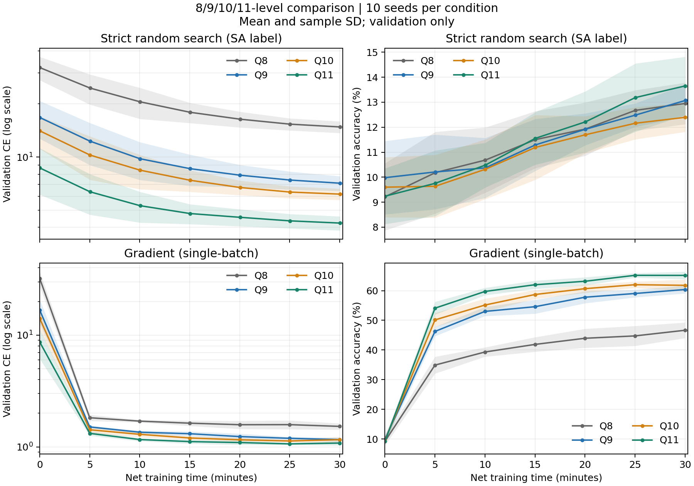

# Time-budget codebook / optimizer comparison

This is the **80-run experiment prepared for the paper revision**: four codebooks × two
optimizers × ten seeds. It is separate from the original Q9/300-epoch update-mode ablation.
It contains no rejected single Q11/300-epoch follow-up result.

## Results without training

From the repository root:

```bash
python3 validate_release.py
python3 additional_experiments/analyze_results.py
```

For the figures, install the optional plotting dependency:

```bash
python3 -m pip install -r requirements-analysis.txt
python3 additional_experiments/analyze_results.py --plot
```

The public records are in [`results/timed_codebooks_80runs/`](../results/timed_codebooks_80runs/):

- `per_run_results.csv`: all 80 completed endpoints, initial validation values, counters and timings.
- `learning_curves.csv`: initial plus six five-minute validation observations for every run (560 rows).
- `protocol.json`: exact condition definitions and the recorded sequence of all 80 runs.
- `provenance.json`: original manifest hashes, sanitized manifests, hardware and dependency records.
- `summary.json`, `SUMMARY.md`: means, sample SDs, intervals and paired codebook contrasts.
- `learning_curves.png`, `learning_curves.pdf`: ten-seed means with ±sample-SD bands.
- `implementation_verification.json`: recorded native exactness and short CLI/queue verification,
  with the tested implementation hashes and environment.



No CIFAR-10 images, pickle checkpoints or per-example predictions are distributed. `NA` means
that a counter is not applicable or was not recorded; it does not mean zero. Original source hashes
refer to the measured implementation; the portable implementation has its own source hashes when run.
The original timed runs did not record a Git commit in their per-run configuration, so that column
is `NA`; their original source hashes are retained in `provenance.json`. New runs record both.

## Network and data

The 174,944-weight bias-free CNN, channel normalization, no augmentation/BatchNorm/output scaling,
45,000/5,000 stratified split (seed 20260826), and native gradient kernels match the original model.
The official CIFAR-10 test set is **not evaluated** in this experiment.

## Codebooks and initialization

| Name | Training codebook | Uniform initial entries |
|---|---|---|
| Q8 | ±1, ±0.5, ±0.25, ±0.125 | ±0.125 (each 1/2) |
| Q9 | Q8 plus 0 | 0, ±0.125 (each 1/3) |
| Q10 | Q8 plus ±0.0625 | ±0.0625, ±0.125 (each 1/4) |
| Q11 | Q8 plus 0 and ±0.0625 | 0, ±0.0625, ±0.125 (each 1/5) |

`codebooks.py` lists each codebook in ascending order. For each seed, one NumPy `default_rng(seed)`
draws full index matrices in Conv1, Conv2, Conv3, FC order with `generator.integers`; the selected
entries all satisfy `abs(w) <= 0.125`. Each coordinate is independent. Draws use the default integer
dtype before conversion to uint8; changing the RNG dtype/draw order can change the sequence.
SA and Gradient start from exactly the same weights within each codebook/seed. Bias is explicitly
zero even for Q8 and Q10. All codebook entries, including ±1, are available during training.

Unlike the original Gradient-mode ablation, **this experiment does not use fan-in sparse
initialization**. The codebooks change both representation and initial distribution/variance.

## Optimization and timing

`sa` is the recorded condition name, but the implemented algorithm is **strict first-improvement
random search**, not temperature-based simulated annealing:

1. Compute the baseline mean CE on all 45,000 training images.
2. Draw eight positions uniformly from all weights, independently with replacement.
3. At each position, choose uniformly from all alternative codebook indexes. Repeated positions
   are edited sequentially; a repeated edit can undo an earlier edit in the same candidate.
4. Evaluate the complete training mean CE and accept only a strict decrease. Otherwise roll back
   every sequential edit in reverse order.
5. End a search on its first improving candidate, or after 100 candidates. Then begin another search.

The full training set is one logical batch, streamed in 128-image forward chunks. There is no
training mini-batch loop, temperature or worsening-loss acceptance. Baseline CE is cached until an
accepted candidate changes it; partial shared-memory weight writes preserve exact forward arithmetic.

Gradient uses `single`, 128 images per gradient, float32 shadow SGD, clipping to [-1,1], nearest
codebook projection (lower index for ties), 350 updates/epoch. Learning rates are 0.01, 0.005,
0.001 in epochs 1–100, 101–200, 201–300. Shadow weights start from quantized initial weights.
The 300-epoch safety limit was not reached in the recorded 30-minute runs.

Both conditions use the improved batched native-Metal forward and the same published kernels.
Backward remains native Metal. Setup, warm-up, validation and checkpoint I/O are outside the net
training budget. Warm-up is restored before timing. SA's initial training-baseline pass is inside
the budget. Time is checked at candidate/update boundaries, so a complete final operation can
overshoot 1,800 seconds. Validation/checkpoints occur at targets 0, 300, …, 1,800 seconds.
Compare the final endpoint, not a best-validation checkpoint.

## Native verification

Requires macOS/Apple Silicon, the recorded main dependencies and CIFAR-10:

```bash
python3 additional_experiments/verify_native.py --data-root data
```

The test checks initial validation values, the exact first three gradients, shadows and quantized
updates against reference hashes generated by the original measured implementation. It also checks
the first two recorded search proposals, checkpoint restoration, duplicate-position rollback,
100 non-improving candidates, and CPU/GPU weight consistency. Outputs go under ignored `runs/`.

The CLI warm-up and timed-run checkpoint/resume paths can also be checked with short runs:

```bash
python3 additional_experiments/verify_timed_runner.py --data-root data
```

These checks do not run the 80 full experiments and their outputs are not experimental results.

## Rerun

Review jobs without training:

```bash
python3 additional_experiments/run_experiment.py --dry-run
```

Start all 80 jobs sequentially (40 hours of net training plus overhead):

```bash
caffeinate -i python3 -u additional_experiments/run_experiment.py \
  --data-root data --output runs/timed_codebooks_80runs
```

Use `--quant-sets 11 --seeds 0` for two conditions of one seed, or run a single condition:

```bash
python3 additional_experiments/timed_run.py \
  --method gradient --quant-set 11 --seed 0 --data-root data \
  --budget 1800 --interval 300 --output runs/example_q11_gradient_seed0
```

SIGTERM/SIGINT requests a save at the next candidate/update boundary. Re-run the same command to
resume a checkpoint; do not change its arguments, source or data. A finished run is not retrained.
An empty `stop_after_current.json` in the queue output directory prevents starting another job.
The queue has a nonblocking lock to reject concurrent launches to the same output. Local checkpoints
are Python pickle files and should only be loaded from your own trusted runs.

After a full rerun, export/analyze to a new directory rather than overwriting the recorded results:

```bash
python3 additional_experiments/import_results.py \
  --run-root runs/timed_codebooks_80runs --output runs/reproduced_tables
python3 additional_experiments/analyze_results.py --input runs/reproduced_tables --plot
```

The source and data hashes are validated before every queued job. Timing throughput and exact update
counts can differ across machines, so identical seconds need not yield identical endpoint weights.

## Interpretation

All conditions have ten seeds. Codebook contrasts use corresponding seeds and exact two-sided
sign-flip p-values; intervals are paired Student-t intervals and SDs use `ddof=1`. These are
descriptive, unadjusted comparisons rather than a preregistered multiple-testing analysis.

The measured sequence was Q9/Q10, then Q11, then Q8; it was not jointly randomized across codebooks.
Within each codebook there were five SA-first and five Gradient-first seeds. Equal elapsed training
time does not equalize image exposure: a search candidate scans all training images, whereas a
Gradient update uses 128. This experiment measures the stated implementations under a wall-time
budget; it does not establish an optimizer's general superiority or isolate the causal effect of
zero/small values independently from initialization.
